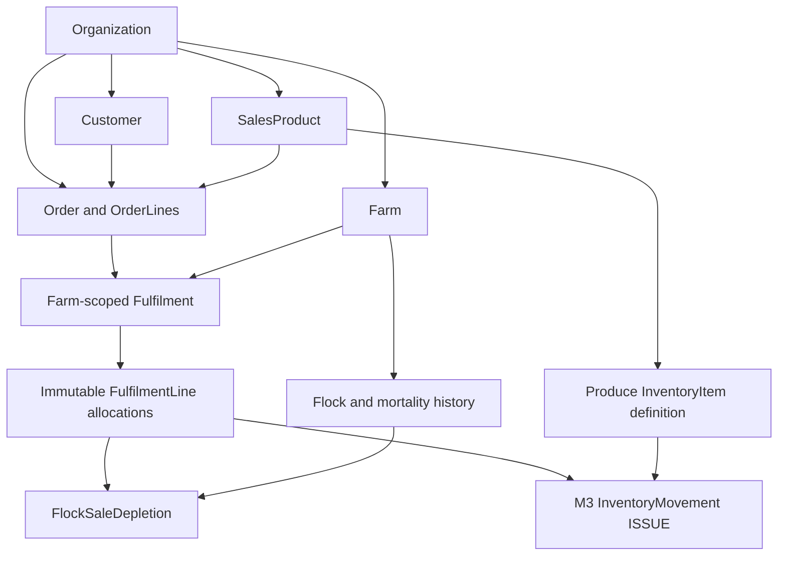
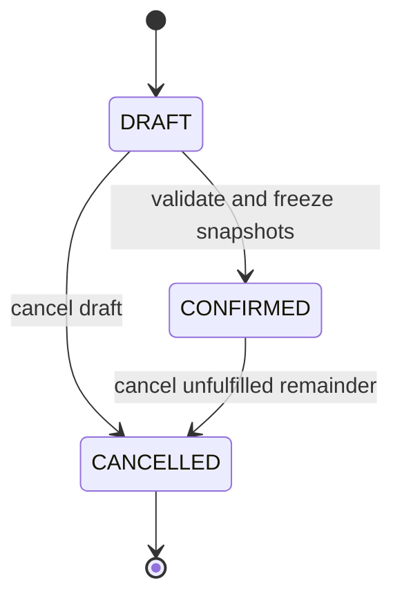
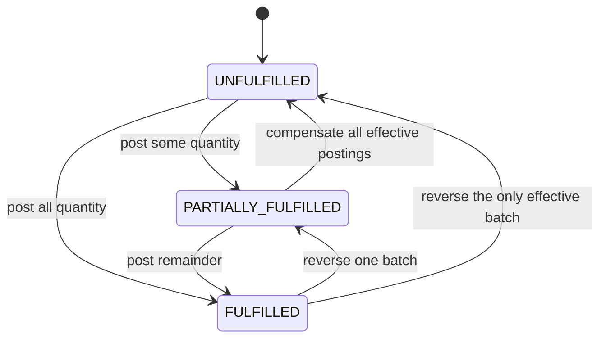
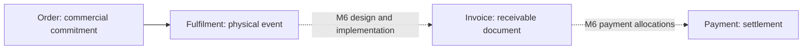
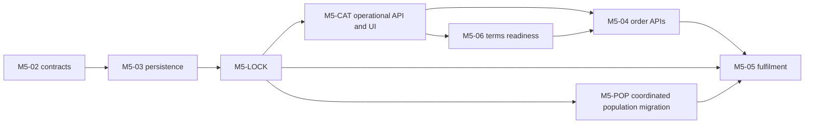

# ADR M5-01: sales orders and farm fulfilment

Status: **Finalized for pull-request review**. Date: 2026-11-12.
Task: [M5-01](https://trello.com/c/NhbQfPVq).
Branch: `m5-01/sales-fulfilment-architecture`.

This is an architecture decision proposal for M5, not an implementation record.
No proposed model, permission, route or changed metric below exists because of
this document. M5-02 has not started. M5 covers orders and physical fulfilment;
M6 owns invoicing, payments and customer financial ledgers.

## Approved decisions for this pull request

The following decisions are approved, not open alternatives. They specify the
later implementation; this documentation does not implement them:

| Decision                     | Approved rule                                                                                                            |
| ---------------------------- | ------------------------------------------------------------------------------------------------------------------------ |
| Initial currency             | JMD only; reject other currency codes. Currency is fixed explicitly, never inferred from locale                          |
| Unit prices                  | Nonnegative Decimal(19,4), snapshotted on confirmed order lines                                                          |
| Order amounts                | Round to two decimal places, retaining the line-level half-up rule in Decision 6                                         |
| STAFF commercial reads       | STAFF may read whole-order commercial totals across supplying farms                                                      |
| Operational source isolation | STAFF must not receive source details from farms they cannot access; commercial read permission never grants farm access |

The approved prerequisite graph is
`M5-02 -> M5-03 -> M5-LOCK -> (M5-CAT / M5-POP)`. M5-CAT and M5-POP are independent
branches after M5-LOCK. M5-04 requires the operational catalog, including its UI;
M5-05 requires completed M5-LOCK and M5-POP as well as order API readiness.
The delivery-plan section spells out the remaining downstream gates. Other
architecture choices remain documented for pull-request review, not silently
promoted to approved production behavior.

## Context and existing implementation

The proposal builds on these inspected sources:

| Existing foundation                                                     | Evidence and implication                                                                                                                                                                                                                                                           |
| ----------------------------------------------------------------------- | ---------------------------------------------------------------------------------------------------------------------------------------------------------------------------------------------------------------------------------------------------------------------------------- |
| Organization, farm, membership, customer and ledger models              | [Prisma schema](../apps/api/prisma/schema.prisma): UUIDs, explicit ownership, restrictive relations, precise quantities and organization-scoped codes                                                                                                                              |
| Verified identity, organization permissions and independent farm grants | [M1 workflow](m1-workflow.md), [FarmAccessService](../apps/api/src/modules/authorization/farm-access.service.ts), [central policy](../apps/api/src/modules/authorization/role-permissions.ts)                                                                                      |
| Organization-owned customers                                            | [M2 documentation](../README.md#m2-customer-and-supplier-master-data), [CustomersService](../apps/api/src/modules/customers/customers.service.ts): customer identity is not farm-owned                                                                                             |
| Farm inventory and negative-stock protection                            | [M3 documentation](../README.md#m3-inventory-foundation), [InventoryStockService](../apps/api/src/modules/inventory/inventory-stock.service.ts): movement-derived stock, stock-position locks and composable transactions                                                          |
| Poultry mortality and feed histories                                    | [M4 workflow](m4-workflow.md), [MortalityService](../apps/api/src/modules/poultry/mortality.service.ts), [FeedUsageService](../apps/api/src/modules/poultry/feed-usage.service.ts): positive events, full compensations and atomic inventory linkage                               |
| Flock population and mutation serialization                             | [metrics](../apps/api/src/modules/poultry/flock-metrics.ts), [history aggregates](../apps/api/src/modules/poultry/poultry-history.ts), [flock lock](../apps/api/src/modules/poultry/flock-mutation-lock.ts), [definition edits](../apps/api/src/modules/poultry/flocks.service.ts) |
| Shared boundaries                                                       | [types](../packages/types/src/api.ts), [validation](../packages/validation/src/index.ts), [pagination](../packages/validation/src/pagination.ts): explicit DTOs, strict Zod allowlists, decimal strings, safe errors and bounded collections                                       |
| Existing validation evidence                                            | [M4-11 audit](audits/m4-11-poultry-coverage.md), [M4-12 report](audits/m4-12-poultry-validation.md); these are prior results, not execution evidence for this proposal                                                                                                             |

There are currently no sales orders, fulfilments or flock sale/depletion records.
M4 derives live population from starting birds minus effective mortality only.
The current M3 item update accepts unit/category changes; it must not be assumed
to protect the meaning of quantities once M5 starts referencing those items.

## Decision 1: ownership, catalog identity and source allocation

An `Order` and its `OrderLine` records belong to an Organization. Each order has
one required Customer in that organization, one currency and one commercial-terms
snapshot. It has **no authoritative farmId**. One order may be supplied by several
permitted farms through separate fulfilments.

Each immutable `Fulfilment` belongs to one organization, one farm and one order.
One command can fulfil multiple lines and multiple sources, including poultry
and produce together, but all its allocations must be at that one verified farm.
Supplying another farm requires another independently authorized command. There
is no cross-farm distributed transaction.

Catalog requirements for later M5 work are:

- Organization-owned `SalesProduct` with stable code, name, active lifecycle,
  `kind=POULTRY|PRODUCE` and sale unit. These are sales definitions, not stock.
- A PRODUCE product references exactly one same-organization `InventoryItem` in
  category `PRODUCE`, using its exact unit. Physical availability comes from the
  selected farm's M3 movements, not the product definition.
- A POULTRY product uses `EACH`, has **no inventoryItemId**, and can be supplied
  from explicitly eligible Flocks. A proposed `PoultryProductSource` association
  records organization/product/farm/flock eligibility and active state. Bird type
  is currently free text; matching labels is not a safe eligibility rule.
- Catalog identity is reusable across farms/batches. Sources are chosen explicitly
  at fulfilment, not permanently allocated when an organization-level order is
  created. Poultry fulfilment records actual birds handed over, not birds promised.
- No automatic maturity/health eligibility threshold is introduced. No weight-to-
  bird conversion, slaughter/processing, egg production or generic livestock model
  is implied. Catalog implementation remains later work, not M5-01. The minimum
  deliverable and its dependency on orders are specified below.

### Sales catalog prerequisite: minimum API and UI

The catalog must be manageable through real APIs and the authenticated UI **before
order creation is exposed**. Hard-coded products, fixture-only UUIDs, a bare product
table or direct database provisioning do not satisfy this prerequisite. All routes
here are proposals. Catalog records define what can be sold; none holds a farm
stock balance, reserves birds, posts a movement or records a handover.

| Method | Proposed route under `/api/organizations/:organizationId`                       | Minimum behavior                                                                                                                                |
| ------ | ------------------------------------------------------------------------------- | ----------------------------------------------------------------------------------------------------------------------------------------------- |
| GET    | `/sales-products`                                                               | Organization-scoped search by code/name; kind and active-state filters; existing bounded pagination                                             |
| POST   | `/sales-products`                                                               | Create name/kind and typed produce link where applicable; server assigns code, ownership, unit and initial active state                         |
| GET    | `/sales-products/:productId`                                                    | Catalog definition and source kind, with readable produce item identity/unit; no unverified farm balances or poultry source list                |
| PATCH  | `/sales-products/:productId`                                                    | Name and permitted pre-confirmation source changes; reject frozen kind/unit/item identity changes                                               |
| POST   | `/sales-products/:productId/deactivate`                                         | Disable new order confirmation/fulfilment without changing snapshots, stock or eligibility history                                              |
| POST   | `/sales-products/:productId/reactivate`                                         | Revalidate linked source definition and restore catalog availability; no physical ledger effect                                                 |
| GET    | `/farms/:farmId/sales-products/:productId/poultry-sources`                      | List this permitted farm's associations with flock code/name, lifecycle and effective eligibility; include inactive associations when requested |
| POST   | `/farms/:farmId/sales-products/:productId/poultry-sources`                      | Attach an active same-farm flock to a POULTRY product, using only `{ flockId }` as an untrusted selector                                        |
| POST   | `/farms/:farmId/sales-products/:productId/poultry-sources/:sourceId/deactivate` | Disable that association; retain its identity and historical references                                                                         |
| POST   | `/farms/:farmId/sales-products/:productId/poultry-sources/:sourceId/reactivate` | Revalidate scoped product/flock and restore that association                                                                                    |

Use `sales-product:read`, `sales-product:manage` and
`sales-product-source:manage` in the centralized policy. Catalog definition reads
do not require a farm. Produce linking also requires inventory:read; poultry
eligibility reads/writes require flock:read and verified access to that farm.
Do not enumerate another farm's associations through the organization detail API.
Association commands constrain source ID, product, organization and farm together.
The scoped product/flock pair is unique; no reparenting or DELETE is supported.
Repeated desired lifecycle states succeed without duplicating a source record.
Creating an already-active pair returns its existing identity; an inactive pair
requires explicit reactivation rather than silently resurrecting it.

PRODUCE create/relink accepts an inventoryItemId plus expectedInventoryUnit. Select
it through the existing organization inventory-item list filtered to active
PRODUCE definitions. Lock and revalidate its organization/category/unit; copy the
verified unit into SalesProduct. The client cannot choose an independent product
unit. A POULTRY product has unit EACH and rejects inventoryItemId. Once confirmed
lines reference a product, kind/unit/item linkage is frozen; a new definition is
needed for different source meaning. Before then, an explicit relink must still
validate under the definition locks. Draft line snapshots include selected catalog
kind/unit/produce item identity; confirmation compares these against the locked
product. A source identity mismatch requires an explicit line edit/revalidation,
never silent retargeting. Deactivation/renaming cannot
rewrite commercial snapshots.

The same produce item can supply that product at many farms; stock is always
read separately from M3 in a verified selected farm. An eligibility association
means a flock is allowed as a source, not that birds have been allocated. A closed
flock or inactive product makes an association ineffective even if its stored
isActive flag remains true; display the reason rather than posting a status
counter. Reactivation of an association requires an active product/flock. Prior
fulfilments/reversals continue referencing their immutable original sources.

Minimum UI, using ApplicationShell, applicationHref, verified application context
and existing M2/M3 management components:

- `/app/sales-products`: permission-aware navigation, code/name/kind/unit/lifecycle
  list, search/filter/pagination, readable linked item and create control.
- `/app/sales-products/new`, `/app/sales-products/:productId` and
  `/app/sales-products/:productId/edit`: typed product forms, detail, safe errors
  and explicit deactivate/reactivate controls. No catalog price/default currency
  is required: agreed unit prices remain order-line inputs, not stock metadata.
- A POULTRY product detail has a farm-scoped eligibility section. With no selected
  farm, ask for an accessible farm before loading sources. Show associations and
  a readable active-flock selector; authorized users attach/deactivate/reactivate.
  Switching farms refreshes only that farm's associations/choices. Free-text bird
  type is descriptive and never automatically grants eligibility.
- A PRODUCE detail shows linked M3 item code/name/unit and links to existing item
  management. Any farm-stock view remains a separate verified M3 view, not a
  catalog quantity field. Catalog actions never manufacture a receipt or ISSUE.
- STAFF can read catalog and permitted-farm eligibility but sees no management
  controls. Server actions recheck permission, organization and farm, independent
  of hidden form values. Include loading, initial/filtered empty, validation and
  safe error states, mobile form stacking and contained table scrolling.

The delivery plan assigns this complete API/UI prerequisite to proposed work
package **M5-CAT**, not to an implicit side effect of order implementation. There is
no catalog implementation or new route in this correction task.



## Decision 2: proposed persistence boundaries

Names below are conceptual Prisma model proposals. They are not schema changes
or a commitment to generate migrations before ADR review.

| Model                  | Ownership and important fields                                                                                                                                                                   | Mutability / constraints                                                                                                                                                 |
| ---------------------- | ------------------------------------------------------------------------------------------------------------------------------------------------------------------------------------------------ | ------------------------------------------------------------------------------------------------------------------------------------------------------------------------ |
| `SalesProduct`         | Organization; UUID/code/name, kind, unit, optional produce inventoryItemId, active state, timestamps                                                                                             | Exactly the source rules above. Kind/unit/source identity frozen once referenced by a confirmed line; rename/lifecycle do not rewrite snapshots                          |
| `PoultryProductSource` | Organization/product/farm/flock, active state, actor/timestamps                                                                                                                                  | Unique scoped product/flock pair; composite ownership links; eligibility changes never alter past depletion                                                              |
| `Order`                | Organization, UUID/generated code, customerId, commercialState, version, currency, CASH/CREDIT terms, confirmed customer/contact snapshot, actor/timestamps                                      | Code unique per organization; draft commercial edits only; confirmation freezes commercial identity/terms; version changes on accepted mutations, not a quantity balance |
| `OrderLine`            | Organization/order, stable UUID/line number, productId, ordered quantity, unit, unitPrice, product code/name/kind/source-identity snapshot, draft removal marker                                 | Confirmed fields immutable; removed draft lines remain auditable. No fulfilledQuantity, stock or bird balance column                                                     |
| `OrderEvent`           | Organization/order, action, order version, actorUserId, server timestamp, reason and bounded before/after commercial changes                                                                     | Append-only create/edit/confirm/cancel/fulfilment/correction audit; no farm-source details in organization-level event DTOs                                              |
| `Fulfilment`           | Organization/farm/order, UUID/generated code, kind POSTING/REVERSAL, occurredAt, createdAt, actorUserId, note/reference, optional unique reversesFulfilmentId                                    | Committed rows immutable. A reversal fully compensates one original batch at the same farm/order; no reversal of a reversal                                              |
| `FulfilmentLine`       | Organization/farm/order/fulfilment/orderLine; positive quantity, source kind, exactly one flockId or inventoryItemId; source code/unit snapshot; optional inventoryMovementId and reversesLineId | One row per source allocation. Unique movement link for produce; unique original-line reversal link; same source/quantity on reversal                                    |
| `FlockSaleDepletion`   | Organization/farm/flock, unique fulfilmentLineId, positive integer birdCount, actorUserId, occurredAt/createdAt, optional unique reversesDepletionId                                             | Append-only poultry ledger. Original adds depletion; full reversal subtracts it. Exactly one matching entry for each poultry allocation; no inventory movement           |
| `FulfilmentCommand`    | Organization/farm, operation POST/REVERSE, idempotency key, canonical request hash/version, actorUserId, resulting fulfilmentId                                                                  | Unique organization/farm/operation/key; committed success receipt only, immutable and retained; written in the same transaction as all effects                           |

Use existing UUID, timestamp, explicit snake-case table mapping and ESM/shared
contract conventions. Add composite candidate keys and foreign keys where needed:

- Order to Customer: `(organizationId, customerId)` references a proposed
  `Customer(organizationId,id)` unique key. That candidate key is **not present
  today** and belongs in a later reviewed persistence change.
- OrderLine to Order: organization/order; allocation to OrderLine:
  organization/order/orderLine; allocation to Fulfilment:
  organization/farm/order/fulfilment. A valid order ID alone cannot authorize
  another order's line. Line numbers are unique within an organization/order.
- Operational sources and reversals retain organization/farm/flock or
  organization/farm/item identity in their keys. Use the existing composite Farm,
  Flock and InventoryItem identities. Actor links retain both User identity and
  same-organization membership, as in M4, with restrictive deletion.
- Add quantity/source CHECK constraints, unique reversal links and linked-ledger
  validation/protection analogous to M4. A deferred constraint trigger can ensure
  every committed poultry allocation has exactly one matching depletion row,
  without a cyclic required foreign key during insertion. Produce allocations
  must have one matching generated ISSUE (ADJUSTMENT for reversal).
- Validate matching source, signed effect, actor and occurrence time across linked
  rows. A movement cannot be reused by another fulfilment or a feed-usage record.
  Never accept a pre-existing movement/depletion ID from the caller.
- Protect new operational rows, their linked inventory movements and audit events
  against UPDATE/DELETE/TRUNCATE. Retain original and reversal rows in history.
  Index scoped order history and `(organizationId,farmId,sourceId,occurredAt,id)`
  aggregate/history access; unique indexes enforce command/reversal deduplication.

This records immutable commercial facts and physical events, not duplicate
persisted derived totals. No Invoice, Payment, balance or allocation-of-money
model is proposed for M5.

## Decision 3: order and line lifecycle

Store commercial state separately from derived fulfilment progress:





The second diagram is a read projection, not a second stored status field.
For each nonremoved confirmed line, define `Q=orderedQuantity` and
`F=sum(posting quantities)-sum(reversal quantities)`, with `0 <= F <= Q`.
Progress is unfulfilled at F=0, fulfilled at F=Q, otherwise partial. Order progress
aggregates all its lines. Draft/removed lines are not fulfilment demand.
F includes every farm's events for that organization/order/line; enforcing Q must
not filter it to the selected farm or the caller's accessible-farm list. These
internal commercial aggregates do not expose unauthorized operational sources.

| Action                           | Rule                                                                                                                                                                                                                                                                               |
| -------------------------------- | ---------------------------------------------------------------------------------------------------------------------------------------------------------------------------------------------------------------------------------------------------------------------------------- |
| Draft create/edit                | Validate active same-organization customer/products and units. Authorized edits may change customer, lines, quantities, prices and terms; append an OrderEvent. Keep stable line IDs; record removal rather than hard deletion                                                     |
| Confirm                          | Require at least one nonremoved positive-quantity line, active customer/products, consistent currency/units and expected version. Capture server-validated customer/product snapshots and freeze commercial fields. Confirmation does not reserve or deplete stock                 |
| Partial/full fulfilment          | CONFIRMED only, current version, active customer/product and source, accessible active farm. Explicit requested quantities must fit each line's effective remainder and source availability. Never silently reduce the requested quantity to stock on hand                         |
| Amend confirmed commercial terms | Reject direct edits, including fulfilled-line changes. Cancel the remaining demand and create a new order for changed commitments; preserve existing fulfilled quantities/prices. No in-place repricing or quantity reduction below history                                        |
| Cancel                           | DRAFT or CONFIRMED with outstanding demand. Close all unfulfilled remainder in one command; do not restore birds or stock. Per-line confirmed amendments/cancellations are intentionally excluded from the initial design. A completely fulfilled order has nothing left to cancel |
| Repeat confirm/cancel            | Revalidate access and return the already achieved state without another transition/event; cancellation cannot be reopened                                                                                                                                                          |
| Reverse fulfilment               | Append full compensating batch; the original stays visible. CONFIRMED progress may become partial/unfulfilled again. A CANCELLED order stays cancelled; no automatic reopening or new demand                                                                                       |

For a CANCELLED order, cancelled remainder is derived as `Q-F`; open quantity is
zero. For CONFIRMED, open quantity is `Q-F`. The cancellation event retains the
then-outstanding quantities as an immutable audit snapshot, not an independently
summed cancelled-quantity ledger. If a later correction reduces F, the cancelled
residual increases while the order remains closed. This avoids reopening a
cancelled order through a correction. A fully fulfilled line on a partly
cancelled order remains fulfilled in its history.

Customer/product deactivation preserves history but blocks new confirmation and
ordinary fulfilment. Corrections may reference inactive customer/product/flock/
item definitions, subject to verified organization and accessible active farm.
An inactive farm must be reactivated through existing authorized administration
before a correction; this proposal does not bypass M1 farm lifecycle policy.

## Decision 4: poultry population authority

Birds never receive InventoryItem identities or inventory ISSUE movements.
`FlockSaleDepletion` means birds actually fulfilled from that flock, independently
of when a customer pays. It does not mean mortality or revenue recognition.

```text
S = current permitted startingBirdCount baseline
M = effective mortality (original deaths minus full mortality reversals)
B = effective fulfilled birds (original depletion minus full depletion reversals)
available birds / live birds remaining on farm = S - M - B
M >= 0; B >= 0; M + B <= S
```

Before posting, aggregate all requested allocations per flock; use its scoped
current mortality/depletion ledgers under the **existing M4 flock mutation lock**.
Reject even if only one bird exceeds availability. No reservation or mutable
current-bird counter is introduced.

This requires a coordinated later M5 integration, before the first depletion can
be posted:

1. Extend a shared server population aggregate to read M and B in one snapshot.
   Fulfilment, flock reads and mortality guards must use that authority.
2. Mortality posting must check `M + proposedDeaths + B <= S`; sales must never
   become death counts. Starting-population edits must check `newS >= M+B`.
   Their current mortality-only checks are insufficient once B exists.
3. Keep effective mortality and its percentage `M*100/S` unchanged. Extend metrics
   with `effectiveFulfilledBirdCount`; explicitly change existing `liveBirdCount`
   to **remaining on-farm birds**, `S-M-B`, and update DTO validation/UI wording and
   affected consumers together. This is an intentional future semantic change,
   not a claim about the current M4 contract. Availability DTOs use this same
   result, not another counter. No separate survivor-total alias is required.
4. Preserve M4 age/maturity rules and UTC as-of semantics. That date still affects
   only age/maturity; population aggregates reflect all current ledger postings.
5. Mortality, mortality reversal, depletion/reversal, baseline edits and lifecycle
   commands share the flock advisory/row lock. No new independently writable
   population field or sale-through-mortality shortcut is permitted.

Example: S=100, M=10 and B=70 leave 20 birds. A request for 21 birds or 21 deaths
fails. Reversing an erroneous 5-bird depletion restores availability to 25;
reversing 2 deaths restores it to 22 if B is still 70. Neither event changes the
other ledger's meaning. Simultaneous death/sale operations must serialize and
re-read M+B, so they cannot both consume the same remaining birds.

### Population contract migration: affected implementation

Call the proposed semantics **population contract v2** in deployment/release
documentation; this is not a current API version or an existing feature flag.
The only additional required metric is `effectiveFulfilledBirdCount=B`. Existing
`liveBirdCount` becomes the nonnegative number **remaining on farm**, S-M-B.
`cumulativeMortality=M` and the six-place decimal `mortalityPercentage=M*100/S`
must not change definition or denominator. AgeDays, ageWeeks, daysToMaturity,
maturityState, startingBirdCount and grouped cumulativeFeedUsage retain their
existing meanings. No live-plus-sold survivor count is labelled remaining birds.

This is the repository impact inventory, including consumers to review even where
no formula change is necessary. Paths beneath `apps/api/src/modules/poultry/`
refer to the current existing module, not a second poultry state architecture.

| Existing file / symbol                                                                                                              | Required change or explicit preservation                                                                                                                                                                                                                             |
| ----------------------------------------------------------------------------------------------------------------------------------- | -------------------------------------------------------------------------------------------------------------------------------------------------------------------------------------------------------------------------------------------------------------------- |
| `flock-metrics.ts`: FlockMetrics, FlockMetricDefinition, calculateFlockMetrics                                                      | Keep FlockMetricDefinition baseline/date-only; require B as a separate authoritative calculation input. Expose nonnegative integer B; validate M>=0, B>=0 and M+B<=S; derive liveBirdCount=S-M-B. Keep mortality percentage and calendar/maturity formulas unchanged |
| `poultry-history.ts`: FlockHistoryScope, effectiveMortality, cumulativeFeedUsage, authorizedFlock                                   | Add effective depletion aggregation with the same organization/farm/flock predicates and original-minus-reversal rule; retain existing mortality/feed aggregates. authorizedFlock stays a scoped lifecycle lookup, not a browser or guard calculation                |
| `flock-metrics.service.ts`: FlockMetricsService.get                                                                                 | Read S, M, B and feed within the same caller-owned or RepeatableRead transaction; pass all aggregates to the shared pure calculation; no independent Sales-only availability query                                                                                   |
| `mortality.service.ts`: MortalityService.post and reverse                                                                           | Post guard becomes M+newDeaths+B<=S; reversal uses the same population authority and lock, preserving positive original/reversal counts and existing full-compensation behavior                                                                                      |
| `flocks.service.ts`: FlocksService.update                                                                                           | Guard proposed starting baseline against M+B after the shared lock; reject a decrease below combined effective depletion, not only mortality                                                                                                                         |
| `flocks.service.ts`: list, get, create, setActive                                                                                   | list/get return v2 metrics with existing scoped counts/filter behavior; create's positive baseline/date rules remain; setActive preserves both ledgers and continues using the same mutation lock                                                                    |
| `flock-mutation-lock.ts`: lockFlockMutation                                                                                         | Keep existing flock advisory keys and row-lock scope; include the parent-lock prelude described in Decision 7. Every M4/M5 population mutation uses this one order                                                                                                   |
| `feed-usage.service.ts`: post/reverse                                                                                               | No population formula or mortality meaning is added; adopt the definition/flock/stock locking protocol below and keep authoritative stock integration                                                                                                                |
| `poultry-response.ts`: metricDetails and flockDetails                                                                               | Map B into the metrics DTO and keep decimal strings. Bare definition/baseline DTO stays unchanged; mortalityDetails/feedDetails keep their event meanings                                                                                                            |
| `flocks.controller.ts`: list/get and mutation handlers; `poultry.module.ts` exports                                                 | Existing list/detail response aliases carry v2. Wire the shared population dependency into existing providers and expose it for Sales composition; do not introduce another metrics endpoint/state store                                                             |
| `packages/types/src/flock.ts`: FlockMetrics, FlockWithMetrics, FlockDetailResponse, FlockMetricsListResponse                        | Required B field and explicit remaining-on-farm comment for liveBirdCount; rebuild response consumers. Flock/FlockResponse and mortality/feed event contracts retain definition/event fields                                                                         |
| `packages/validation/src/index.ts`: createFlockSchema/updateFlockSchema, postMortalitySchema                                        | Keep positive starting/death counts and strict writable allowlists. Continue rejecting liveBirdCount, B, ownership and metrics as input; combined availability is a transactional domain guard, not client Zod arithmetic                                            |
| Same shared file: flockMetricsQuerySchema/flockApiQuerySchema/poultryHistoryQuerySchema, plus `packages/types/src/index.ts` exports | Keep explicit UTC age/maturity date, maturity filters, pagination and exports. There is currently no shared Zod flock-metrics response schema to update: response validation lives in the web adapter below                                                          |
| `apps/web/lib/management/flock-api.ts`: flockWithMetricsSchema, flockDetailResponseSchema, flockListResponseSchema, loadFlock       | Require and preserve B when parsing list/detail responses; validate nonnegative count shape; never default absent B to zero after enablement. Bare flockResponseSchema stays a definition response                                                                   |
| `apps/web/app/app/flocks/page.tsx`                                                                                                  | Rename live population presentation to remaining-on-farm birds and show effective fulfilled birds separately; display API numbers only; retain server filtering/pagination                                                                                           |
| `apps/web/components/flocks/details.tsx`: FlockDetails, FlockMortality, FlockAge, FlockMaturity                                     | Detail shows starting, remaining-on-farm and net fulfilled counts. FlockMortality still shows deaths and percentage of starting population; age/maturity views remain unchanged                                                                                      |
| `apps/web/app/app/flocks/[flockId]/page.tsx` and `[flockId]/edit/page.tsx`                                                          | Consume v2 loadFlock results and refreshed detail/form props; retain selected organization/farm authority and existing permissions                                                                                                                                   |
| `apps/web/components/flocks/forms.tsx`; `apps/web/app/app/flocks/actions.ts`: updateFlockAction/postMortalityAction                 | Explain the starting baseline rather than implying it edits live birds. Preserve verified mutation flow and revalidation; mortality error still means insufficient remaining birds                                                                                   |
| `apps/web/lib/management/api.ts`: FLOCK_OVER_MORTALITY message                                                                      | Current baseline-edit message mentions recorded mortality alone; change it to explain effective mortality plus fulfilled birds. Keep the code and safe existing posting error mapping                                                                                |
| `apps/web/components/flocks/posting-form.tsx`, `history.tsx`; `apps/web/lib/management/poultry-api.ts`, `poultry-form.ts`           | Preserve input/reset/pending behavior and refreshed API state. Mortality history must never mix in sales as deaths; feed history/stock choices and local-time conversion remain separate. Sales history belongs to fulfilment UI                                     |
| `apps/web/lib/management/flocks.ts`; `apps/web/app/app/flocks/new/page.tsx`                                                         | Preserve UTC boundary helper, maturity labels, six-field definition allowlist and changedFlockForm behavior; no writable B field and no browser population math                                                                                                      |
| AuthGuard, AuthorizationGuard, FarmAccessGuard, flockScope/verified application context                                             | Preserve authorization/tenant/farm enforcement. These are not population business guards; do not add role checks or population calculations there                                                                                                                    |
| Existing metrics/unit/integration/action/browser fixtures and M4 workflow documentation                                             | Rebuild fixtures for the required field, extend focused cases below, and update current formula/labels. Keep M4-11/M4-12 execution reports as historical evidence, not proof of new M5 behavior                                                                      |

### Coordinated rollout and write barrier

The change to liveBirdCount is intentionally incompatible in meaning once B>0.
An additive B field alone does not make an old mortality writer safe. The proposed
work package **M5-POP** must finish this migration before **any** depletion writer
is registered/enabled in production:

1. Install the later reviewed depletion/receipt persistence with the depletion
   ledger empty. Keep fulfilment POST/reversal routes and all internal writers
   unavailable or fail-closed behind a server-side deployment gate. No public
   request/header/UI flag can enable it. Existing mortality/feed behavior remains
   operational; synthetic B fixtures are confined to disposable tests.
2. Deploy population-v2 aggregation, M4 post/edit/reversal guards, response types,
   web parser and UI wording together while B remains zero. Also finish the
   cross-domain locking work package M5-LOCK below. Rebuild all shared packages and
   application consumers. Missing table/field/aggregation failure must fail safely,
   never fall back to mortality-only availability or assume missing B is zero.
3. Drain old API instances, old web server actions, background/internal mutation
   callers and in-flight old transactions. A coordinated maintenance cutover is
   the initial deployment strategy; do not run old mortality/baseline writers next
   to enabled Sales. Verify all repository consumers above and any deployed
   external API consumers accept the changed semantics. Refresh cached views and
   require stale clients to reload rather than trust cached available counts.
4. With the Sales write gate still closed, pass zero-depletion compatibility and
   synthetic-depletion integration/browser checks, including permission/farm
   isolation. Sign off a deployment manifest identifying compatible API/web/shared
   builds and completed schema/M5-LOCK/M5-POP prerequisites; version is a server-side
   capability, not a client-supplied authorization claim.
5. Only M5-05, after those prerequisites, may expose/enable posting and correction.
   The central domain writer must check the gate as well as controller access,
   so an internal caller cannot bypass it. Gate enablement is an explicit deployment
   step after catalog/order readiness, not an automatic consequence of adding a
   table or granting a permission. Verify the first permitted posting refreshes
   both existing flock routes and future Sales availability from one authority.
6. Rollback: first disable new M5 posting/correction. If any B history exists,
   **do not roll back to mortality-only M4 code**, discard ledger events or reset
   B to zero. Keep population-v2 M4 reads/mutations and metadata safeguards running;
   fix forward or roll back only to a v2-compatible build. No reversal is posted
   merely to make a software rollback appear safe.

### Focused population acceptance criteria

Extend existing suites; these are future acceptance requirements, not tests added
or executed for this documentation correction:

- B=0 preserves every existing M4 metric value, exact exhaustion, rounding,
  age/maturity boundary and date-only/current-ledger distinction. Reuse existing
  `flock-metrics.spec.ts` coverage instead of copying it into Sales.
- One mixed-history vector S=100, M=10, B=70 must yield remaining=20, mortality=10
  and mortalityPercentage="10" in both list/detail and Sales availability, with
  B reported separately. Reverse one ledger at a time and confirm only its net
  effect changes; another organization/farm/flock contributes nothing.
- Extend M4-11's existing post-vs-baseline race to M+B. With a controlled barrier,
  race sale-vs-mortality and sale-vs-baseline reduction: each permitted serialized
  outcome preserves M+B<=S and the losing operation leaves no physical/audit
  partial effects. Use the real shared lock/transaction, not sleep-based ordering.
- Reuse the two-order last-birds case in M5-05 and verify distinct idempotency keys
  cannot both consume the same availability. Race a full depletion correction with
  a new sale: no duplicate restoration or negative B. Preserve the existing
  mortality-reversal and double-reversal checks rather than duplicating a matrix.
- Confirm close/reactivate preserves M and B, closed-source posting remains denied,
  starting quantity below M+B fails, and original/reversal histories stay visible.
- Extend one existing real-API browser workflow after a sale: remaining-on-farm
  drops while deaths/percentage stay unchanged, then a death refreshes remaining
  again. Update existing action/error assertions and verify mobile/desktop labels;
  retain existing farm-switch/auth coverage rather than creating another shell test.
- The write-barrier acceptance check must reject a disabled/incompatible writer,
  including direct domain composition; missing B must trigger safe API/web error
  handling. No deployment can be approved solely because a new Sales endpoint
  calculates its own correct availability while old M4 writers remain unsafe.

## Decision 5: produce inventory and operational corrections

For each produce allocation, validate the product's same-organization PRODUCE
item and exact unit at the selected farm. In the fulfilment transaction call
M3 `postMovementInTransaction` with `quantity=-allocationQuantity`, reason ISSUE
and verified actor/farm. Create its immutable FulfilmentLine linked to the new
movement. Never call a separately committing inventory endpoint or create a
second stock balance. The shared M3 stock lock and negative-stock policy apply
to sales and every other outbound consumer.

If any poultry source, produce source, line limit, movement or persistence check
fails, roll back the **entire command**: all fulfilment rows, movements, depletion
events, audit changes and command receipt. Explicit partial fulfilment is a
smaller successful command, not a partially committed failed command.

A proposed correction reverses one complete original fulfilment batch, including
all its allocations, in one transaction:

- Append a REVERSAL header/lines linked to the originals, with a mandatory reason
  and current actor/time. Counts and quantities remain positive in event rows.
- Poultry: append a matching full depletion reversal; aggregate B decreases.
- Produce: use M3 to append a **positive ADJUSTMENT** for the original quantity,
  item and farm; link it to the reversal line. Preserve the original ISSUE.
- Validate all originals are in the selected organization/farm/order, are ordinary
  postings and have no prior reversal. Unique links prevent duplicate compensation.
  Reversals cannot themselves be reversed. A corrected replacement is a new posting.

Reversal is for a verified **posting error**, not order cancellation or a customer
return. Require the authorized actor's auditable attestation that the compensated
quantity was not actually handed over (for example, an erroneous duplicate record).
Do not restore stock/birds for
an actual completed handover merely because a customer cancels or has not paid.
Customer returns, stock-condition assessment and financial credits are deferred
to M6; they are not implicit M5 reversals. Partial batch corrections
are excluded initially: fully compensate an erroneous batch and repost its correct
allocations, preserving both histories. Separate commands do not promise atomic
replacement; each must independently satisfy current availability/order limits.

### Required inventory metadata protection

Current `InventoryItemsService.update` permits unit/category changes. Proposed
work package **M5-LOCK** must close this gap across existing consumers, not just add
a Sales-specific item lock. All entries in the following inventory are existing
methods; the lock changes are proposals.

| Existing method and file                                                                            | Current path                                                                                                                                                                         | Required protocol participation                                                                                                                                                                                                                                |
| --------------------------------------------------------------------------------------------------- | ------------------------------------------------------------------------------------------------------------------------------------------------------------------------------------ | -------------------------------------------------------------------------------------------------------------------------------------------------------------------------------------------------------------------------------------------------------------- |
| `InventoryItemsService.create` in `inventory-items.service.ts`                                      | Own transaction; Organization FOR UPDATE allocates INV codes, then inserts the definition                                                                                            | Organization code lock first; no attempt to take it after source/stock locks. Creation itself creates no stock                                                                                                                                                 |
| `InventoryItemsService.update`                                                                      | Scoped updateManyAndReturn currently changes name/description/unit/category/threshold without reference guards                                                                       | One transaction: parent prelude, exclusive item-definition lock, re-read references, validate permitted change and update. Do not inspect references before waiting for the lock                                                                               |
| `InventoryItemsService.deactivate`, `reactivate`, private `setActive`                               | Direct scoped lifecycle update                                                                                                                                                       | Same parent/item-exclusive order; preserve history and serialize subsequent consumer eligibility checks with lifecycle changes                                                                                                                                 |
| `FarmInventoryController.postMovement` in `farm-inventory.controller.ts`                            | Validated farm command calls InventoryStockService.postMovement directly                                                                                                             | Preserve guards and pass expectedInventoryUnit; there is no movement writer in FarmInventoryService (its listStock/listMovements are reads)                                                                                                                    |
| `InventoryStockService.postMovement` in `inventory-stock.service.ts`                                | Opens transaction, delegates to postMovementInTransaction                                                                                                                            | Acquire parent/definition prefix before stock and commit once; no second independently committing call from composed operations                                                                                                                                |
| `InventoryStockService.postMovementInTransaction`, private verifyOwnership                          | Checks scoped ownership, takes stock advisory lock, sums balance and inserts movement; currently no definition row lock, expected-unit precondition or generic active-item rejection | Use the caller's transaction and prepared complete lock set, or acquire the entire required prefix before its first stock lock. Revalidate owned unit/eligibility under held definition locks; preserve exact existing stock key and negative-stock arithmetic |
| `FeedUsageService.post` in `feed-usage.service.ts`                                                  | Own transaction; active flock/FEED lookup, stock ISSUE, then FeedUsage insert                                                                                                        | Parent -> item definition -> flock -> stock; re-read active flock and active FEED item after locks, call postMovementInTransaction, then insert linked usage atomically                                                                                        |
| `FeedUsageService.reverse`                                                                          | Reads scoped immutable original, stock ADJUSTMENT, then FeedUsage reversal insert                                                                                                    | Read only to discover original item/flock IDs; acquire the same ordered locks, recheck scoped original/reversal uniqueness, post positive ADJUSTMENT and reversal atomically. Inactive source definitions remain permitted for correction                      |
| Existing `lockFlockMutation` callers: MortalityService.post/reverse, FlocksService.update/setActive | Flock advisory/row lock; subsequent writes reference parent organization/flock                                                                                                       | Adopt the parent prelude without changing flock/stock key formats. They skip inventory stages when no item is involved; never take an item or Order lock after a flock lock                                                                                    |

File prefix is `apps/api/src/modules/inventory/` for inventory methods and
`apps/api/src/modules/poultry/` for poultry methods. Read adapters, seed/fixture
inserts and direct persistence tests are not production movement entry points;
production callers must not bypass the shared protocol with raw movement inserts.
InventoryStockService.getStockOnHand/listFarmStock and its private verifyFarm
helper are read paths, not additional movement writers.

The generic current M3 helper checks item ownership and stock, not item isActive.
Keep that distinction: feed and Sales must check their active/category eligibility
under the shared locks; full corrections permit original inactive definitions.
M5-LOCK does not silently redefine all standalone M3 movements as forbidden on an
inactive item. Its existing movement authorization/negative-stock rules remain;
changing that broader M3 business policy would require a separate explicit decision.

Definition rules under the exclusive item lock:

- Freeze unit once **any inventory movement, SalesProduct reference or confirmed
  line** depends on the item. Including catalog references closes the draft-only
  relabelling gap in the initial ADR. Freeze category once referenced by a produce
  SalesProduct or historical FeedUsage. Inactive catalog/history references do
  not release these protections; use a new definition for different source meaning.
- Check both current data and dependency rows after lock acquisition. Catalog
  create/relink/confirm must hold a shared lock on that item while inserting the
  reference; thus an exclusive definition edit cannot race a first dependency.
- Name/description/threshold and lifecycle may still change under the same lock;
  historical commercial/source snapshots remain unchanged. The lock is global
  to the organization/item, not just one farm's stock position.
- Existing movement rows have no original-unit snapshot. Review legacy unit meaning
  before catalog enablement; do not guess conversions or silently backfill balances.

**Stale-unit request check:** locking alone cannot detect that a caller entered
KG while a still-unused item was legally changed to EACH. Add a required
expectedInventoryUnit precondition to the later M3 movement and M4 feed posting
contracts. It is compared with the locked authoritative item, never used as unit
authority or a conversion instruction. M5 derives the expected unit from the
frozen line, not a writable fulfilment price/unit field. Internal corrections use
their verified original source and the history-frozen item unit. A mismatch is a
safe definition-changed conflict; retain inputs and require reload/review, not
automatic reinterpretation/retry using the new unit.

This later contract change affects `createInventoryMovementSchema` and
`postFeedUsageSchema` plus their inferred inputs in `packages/validation/src/index.ts`,
FarmInventoryController, PostInventoryMovementInput, PostFeedUsageInput and their
callers. Update `apps/web/components/inventory/movement-form.tsx`,
`apps/web/app/app/inventory/stock/actions.ts`, `components/flocks/posting-form.tsx`
and `app/app/flocks/actions.ts` to submit the selected/displayed expected unit;
`lib/management/poultry-api.ts` already provides FeedChoice.unit. Inventory definition
forms/actions must surface frozen-field conflicts safely. No new physical balance
or unit-conversion model is added. These method/type/UI edits belong to M5-LOCK,
not this documentation task.

Deploy M5-LOCK with a coordinated write pause for affected definition/movement/feed
writers, drain old callers, then resume only upgraded contracts/protocols. Otherwise
an old stock-only writer can bypass the new definition lock. This is a prerequisite
to catalog link creation, not protection deferred until the first sale. Read-only
workflows can remain available; existing request authorization stays unchanged.

## Decision 6: units, exact decimals and commercial snapshots

Reuse the existing physical unit values EACH/KG/G/L/ML. EACH on a poultry line
does not imply an inventory item. Poultry quantities and depletion counts must be
positive whole birds, bounded by the existing 32-bit starting-population range.
Produce quantities use `Decimal(18,3)` in the inventory item's exact unit; EACH
sales also require whole units. Do not round a requested quantity to fit, convert
units implicitly or treat a fractional old M3 EACH balance as a whole extra item.

Approved pricing is a nonnegative `Decimal(19,4)` unit-price snapshot per line.
Initial order currency is **JMD only**. Shared contracts must permit only the
literal JMD, and all prices/amounts on an order use it. Reject every other currency
code; do not infer currency from locale or an assumed organization setting.
Adding another currency requires a separate reviewed decision rather than a
configurable client allowlist or an implicit scale conversion.
No exchange rate, mixed-currency order, tax engine, discount engine or costing is
included; record the authorized agreed unit price.

Confirmation freezes customer code/name/contact/address, product code/name/kind,
sale unit, ordered quantity, unit price, currency and commercial terms. Changes to
customer/catalog definitions do not reprice confirmed orders or change historical
identity. Draft changes remain auditable through before/after OrderEvents; only
confirmed snapshots are immutable commercial commitments.

Use exact server Decimal operations with a local high-precision constructor
(proposed precision 80), never binary floating point/global M3 precision changes.
An ordered line's displayed amount is `roundHalfUp(Q*unitPrice,2)`; the order amount
is the sum of its rounded line amounts, expressed in JMD to two decimal places.
Format serialized/displayed order amounts with two fractional digits without
reducing the stored unit-price precision. With at most 100 lines, quantity and price
bounds above fit a proposed `Decimal(38,2)` output range. Totals are derived, not
persisted balances. Send decimal quantities, prices and amounts as strings and
validate scale/range with shared strict Zod contracts, following M4's decimal-
string boundary. Poultry counts remain safe bounded integers.

Order amounts are commercial commitments, not invoices or amounts receivable.
Do not accumulate independently rounded partial-fulfilment amounts into a balance;
M6 must define invoice rounding/allocation using frozen unit prices and quantities.

`CASH` means intended payment at sale/handover; `CREDIT` records agreed positive
integer credit-term days. CASH has no credit-term days. Terms freeze at confirmation
and do not mark anything paid. M5 neither collects cash nor verifies credit limits,
calculates invoice due dates, allocates payments or posts customer balances.
The due-date clock and enforceable payment/credit-release rules belong to M6.

## Decision 7: availability and transaction/concurrency strategy

There are **no stock or bird reservations** in initial M5. Drafts/confirmation
record demand and may exceed current supply; confirmation is not a supply promise.
Any preflight availability is advisory and scoped to a permitted selected farm.
Physical overselling is prevented only by authoritative checks at fulfilment commit.
Backorders are simply confirmed remaining demand, without new reservation/forecast
entities or automatic allocation. This deliberately avoids promising inventory
that can also be consumed by mortality, feed usage or other M3 issues.

One bounded command handles one order/farm and up to 100 allocations, covering
at most 100 order lines. These proposed technical caps bound lock sets and payloads;
they are not a biological/business threshold. Execute with PostgreSQL READ COMMITTED,
matching M3/M4 mutation behavior, using this **one canonical lock hierarchy**.
Skip stages that a command does not need; never acquire a new earlier-stage lock
after a later stage. Nonlocking scoped reads may discover immutable source IDs
but do not authorize a write or validate final availability.

| Stage                   | Lock and ordering rule                                                                                                                                                                                                                                                                                                                                                                                         |
| ----------------------- | -------------------------------------------------------------------------------------------------------------------------------------------------------------------------------------------------------------------------------------------------------------------------------------------------------------------------------------------------------------------------------------------------------------- |
| 0. Parent prelude       | Lock the scoped Organization row FOR KEY SHARE before business locks, covering implicit organization FK locks. Commands allocating existing sequential codes take FOR UPDATE instead, upfront, never by later upgrade. Existing InventoryItemsService.create already takes that exclusive parent first                                                                                                         |
| 1. Request identity     | Acquire scoped idempotency advisory lock for fulfilment/reversal; inspect a committed receipt after current authorization. Other commands skip it                                                                                                                                                                                                                                                              |
| 2. Commercial aggregate | Lock existing Order FOR UPDATE before any definition/source locks. Confirm, cancel, draft edit and new fulfilment/reversal use this order. Validate expected version and increment on a new accepted mutation, never replay                                                                                                                                                                                    |
| 3. Definitions          | Fixed table order: Farm, Customer, SalesProduct, PoultryProductSource, InventoryItem; within each, ascending scoped UUID. Readers hold FOR SHARE, definition/lifecycle writers take FOR UPDATE upfront. A writer may skip unrelated tables but must not lock them later or upgrade a held SHARE lock                                                                                                           |
| 4. Poultry sources      | For every distinct flock, sorted farm/flock UUID, take existing M4 advisory lock then scoped flock row FOR UPDATE. Include flocks referenced by feed usage as well as mortality/depletion. Revalidate active/ownership policy after waiting                                                                                                                                                                    |
| 5. Stock positions      | Preacquire all required existing M3 advisory keys, sorted farm/item UUID, before any movement insert. Keep the same `(hashtext(organizationId), hashtext(farmId:itemId))` keys as postMovementInTransaction; no Sales-specific replacement lock                                                                                                                                                                |
| 6. Effects              | Re-read authoritative S/M/B, whole-order line F and stock under locks. Insert matching movements, depletion/usage/fulfilment/audit/receipt rows and version change; commit once. FK checks on shared mutable sources and helper calls must not introduce earlier-stage locks after this prefix; new self-owned parents and immutable confirmed/history references are distinct from those mutable source locks |

The parent prelude prevents an organization code allocator and a late implicit
Organization FK check from inverting parent/source locks. For physical fulfilment,
use a generated receipt code derived from its UUID (`FUL-<UUID>`), rather than
taking an Organization sequential-code lock after sources. Order/catalog code
allocation can reuse the existing serialized pattern at stage 0; neither creates
physical effects. This makes code allocation compatible with concurrent source
operations and does not introduce a financial document sequence.

The previous broad instruction that feed needed only item/stock locks omitted
FeedUsage's flock FK. A concrete possible cycle is: feed holds FEED stock and waits
on a flock's implicit key-share lock; mixed fulfilment holds that flock and waits
on PRODUCE stock; a composed M3 transaction holds PRODUCE stock and requests the
FEED stock. This does not assume one item can be both categories. **Feed post and
reverse therefore take the shared
flock mutation lock at stage 4 before stock**, even though feed changes no bird
count. This is the concrete lock-order correction to the initial ADR. It also
serializes feed's active-flock check with close/reactivate; correction still
permits a closed original flock as M4 already does.

M3 ordinary receipt/issue/adjustment uses stages 0, 3 and 5; item-definition edits
use 0 and 3 only. M4 mortality/baseline/lifecycle uses 0 and 4; M4 feed uses 0, 3,
4 and 5. Catalog source management uses 0, 3 and 4: take the same scoped flock
lock before validating active eligibility or inserting its association/FK; it
never acquires stock or Order locks.
M5 mixed fulfilment/reversal uses the complete hierarchy. Farm/customer/catalog
lifecycle writers must not take an Order lock after a definition lock.

For batch fulfilment, plan the **complete** item/flock/stock lock sets before
calling helpers. An internal prepared-lock context may describe held locks; it
must be server-created, not a body claim or a second stock state store. A helper
cannot acquire the next item's definition after already locking the first item's
stock. Reacquiring an already held lock in postMovementInTransaction is safe;
acquiring an unplanned earlier lock is not. Its owning caller must retain the
transaction, and inventory exceptions must propagate to rollback.

M5-LOCK installs this protocol across current M3/M4 mutation methods and compatible
catalog paths before Sales activation. M5-POP uses the same parent/flock helper;
the advisory key formats do not change. Definition reference checks use scoped
queries after the exclusive item lock, without trying to lock a Product/Order
later. Catalog link/confirmation holds the item shared lock while committing the
new reference, so READ COMMITTED rechecks see the serialized winning change.

Acquire all locks before availability decisions. A second order selling the same
last birds waits on the same flock lock and must then see the first depletion.
Concurrent produce/feed/manual outbound movements share M3 stock protection.
Concurrent cross-farm fulfilment of the same order cannot exceed Q because both
commands take its Order row lock. A bounded deadlock/lock-timeout/serialization
failure rolls back; clients retry the same intent/key with backoff. No exception
is swallowed to commit part of the command.

### Focused inventory locking acceptance criteria

Extend existing stock/feed integration suites and M5-05's needed cases; do not
create a new framework or copy the M1 authorization matrix. All scenarios below
use independent real transactions, deterministic barriers where appropriate,
bounded completion and invariant assertions, not sleep-based scheduling:

- First movement versus unit edit on a previously unused item: if the edit wins,
  a request with the old expectedInventoryUnit fails without movement/FeedUsage;
  if movement wins, the later unit edit sees the committed reference and fails.
  Stock must never be silently interpreted in a different requested unit.
- First catalog link versus unit/category edit: link-first freezes the metadata;
  edit-first requires catalog to revalidate or reject stale expected unit/category.
  Repeat with an active feed post versus changing FEED to PRODUCE: only a valid
  serialized result commits, never an ISSUE without its valid FeedUsage.
- Deactivate versus feed/produce fulfilment: shared/exclusive definition locks
  order the outcomes; an ordinary domain posting ordered after deactivation is
  rejected, and an already committed physical event remains. Reuse a standalone
  M3 movement/correction case to confirm its existing ownership/stock policy is
  preserved rather than assuming the generic helper rejects every inactive item;
  full feed/fulfilment correction can still compensate inactive definitions.
- Exercise the three-party FEED-stock -> flock -> PRODUCE-stock -> FEED-stock
  scheduling described above. The third participant composes two existing
  postMovementInTransaction calls in a test-owned transaction; it is not an
  invented public M3 batch endpoint. With the corrected prefix, feed waiting for
  the flock holds no stock, and the composed M3 caller has preplanned its complete
  definition/stock sets. All complete within the bound with correct net stock and
  one usage/fulfilment effect each; never fabricate a dual-category item. This
  case also verifies the previously late implicit flock-FK lock is covered.
- Two multi-item operations on distinct orders present allocations in opposite
  input order. Their planned definition/stock locks still use the same sorted
  order; no item definition is acquired after stock. Reuse existing concurrent
  M3 insufficient-stock checks to assert at most available quantity commits.
- Feed reversal versus new usage/manual issue, and mixed fulfilment reversal
  versus new issue: same item/stock keys serialize; duplicate compensation leaves
  neither a second ADJUSTMENT nor an orphan reversal/receipt. A failure after
  any ISSUE rolls back all other sources and command receipt.
- Existing hash-based locks can still over-serialize, and PostgreSQL may detect
  other transient deadlocks. A bounded failure must roll back and allow an exact
  retry/idempotent receipt; tests must not treat retrying a partial commit or
  increasing timeouts as proof of correct lock ordering.

Use consistent read snapshots for list/history/count/derived aggregates, following
existing RepeatableRead reads. Never filter an already-paginated page in memory
and call it a complete filtered result. No persisted fulfilled/available counters
are needed for concurrency correctness.

## Decision 8: idempotency and retry behavior

Require a client-generated UUID `Idempotency-Key` for POST fulfilment and reversal.
It identifies one intent; it is not organization/farm authority. Uniqueness is
`(organizationId,farmId,operation,key)`, not a global key and not a stock reference.

Compute a versioned server hash of the canonical validated request: order ID,
expected order version, normalized/sorted line/source allocations and exact
decimal quantities, supplied occurrence time, note/reference, or original batch
and mandatory reversal reason/attestation. Reject duplicate line/source pairs; equivalent
decimal spellings normalize identically. Actor and scope are verified separately,
never accepted from a body. A receipt also binds the authenticated actor.

- Same key/hash/actor, concurrent or later: after fresh permission/farm checks,
  return the **same committed immutable receipt/resource and original success
  status**, with no new ledgers, event or version increment. Replays resolve before
  mutable order version, stock, customer lifecycle or product eligibility checks;
  later changes must not make a committed original appear to have failed.
- Same scoped key with another payload or actor: safe 409 conflict; do not expose
  the old payload. Revoked organization/farm/permission access is still denied.
- Crash before commit: rollback all effects and no committed receipt; retry may
  perform the operation. No persistent PROCESSING row, expiring Redis deduplication
  or notification job is required.
- Crash/lost response after commit: retry finds the receipt, even if the order is
  now fulfilled/cancelled or availability has changed. Use GET for current order
  state; a receipt is not a mutable aggregate snapshot.
- Failed business validation: no success/key record survives. A later unchanged
  retry can succeed if the condition changes; use a new key for a changed intent.
  A new command with stale expected version receives an order-version conflict,
  not a silent refresh/retry that changes the user's intent.

The key transaction lock serializes duplicates even before receipt insertion;
the database unique constraint is the final guard. Retain successful keys with
their operational history rather than expiring them and permitting an old replay
to create another physical issue. This is database idempotency, not form reset.

## Decision 9: authorization and isolation

Extend the existing centralized permission policy; do not add role comparisons in
controllers, a second session system or payload-derived access. The proposed matrix
is for review and does not grant any current M5 capability:

| Proposed catalog permission   | OWNER / ADMIN | MANAGER | STAFF |
| ----------------------------- | ------------- | ------- | ----- |
| `sales-product:read`          | Yes           | Yes     | Yes   |
| `sales-product:manage`        | Yes           | Yes     | No    |
| `sales-product-source:manage` | Yes           | Yes     | No    |

Source management additionally requires flock:read and selected-farm access;
produce linking requires inventory:read. These permissions do not imply inventory
movement or flock-definition management permission.

| Proposed permission                  | OWNER / ADMIN | MANAGER | STAFF |
| ------------------------------------ | ------------- | ------- | ----- |
| `order:read`                         | Yes           | Yes     | Yes   |
| `order:manage` (draft creation/edit) | Yes           | Yes     | No    |
| `order:confirm`                      | Yes           | Yes     | No    |
| `order:cancel`                       | Yes           | Yes     | No    |
| `fulfilment:read`                    | Yes           | Yes     | Yes   |
| `fulfilment:post`                    | Yes           | Yes     | Yes   |
| `fulfilment:reverse`                 | Yes           | No      | No    |

Catalog permissions above must be delivered by M5-CAT before order creation;
they do not replace order/fulfilment permissions. Permissions remain
organization-specific. Farm access still uses current FARM_ACCESS_ALL or active
assignments; a sales permission never grants an unassigned farm.

Organization order reads deliberately expose commercial customer/line snapshots
and **whole-order** derived fulfilment quantities across farms. This is the chosen
organization-level commercial visibility; STAFF's whole-order commercial totals
are **approved**, while other unapproved role-matrix details remain proposals;
it is not an accessible-farms-only total that could misstate an order's progress.
It must not include source flock/item availability, farm operational histories or
source event IDs from inaccessible farms. This restriction is approved and must
also hold in nested DTOs, audit projections, errors and operational pagination
counts; hiding a UI control alone is insufficient. Operational history/source selection
requires fulfilment:read plus verified farm access (and existing flock:read or
inventory:read for source lookup). Authorization applies to pagination counts too.

Posting requires order:read and fulfilment:post with selected farm access; reversal
requires order:read and fulfilment:reverse with that access. Internal ISSUE or
depletion composition is authorized by the fulfilment permission, not by granting
arbitrary manual inventory adjustments or calling the mortality posting API.
Revalidate context, order/customer/product and every source relationship in the
service transaction. An organization-level customer ID does not confer farm access.
Do not require access to every supplying farm to edit/cancel commercial demand;
cancellation changes no farm ledger and cannot return stock.

Foreign/missing organization resources have indistinguishable safe not-found
responses within an authorized scope. Invalid/inaccessible farm selection retains
M1's safe forbidden response. Verify access before inspecting idempotency receipts
or exposing a correction target. No caches or browser state become authority.

## Decision 10: proposed API surface and shared contracts

**Every route in this section is proposed, not implemented.** Use the current
bearer authentication, guards/decorators, verified context and standard envelopes.
The minimum proposed catalog routes/UI are defined in Decision 1 and delivered
by M5-CAT first. The following table adds order/fulfilment proposals; none is added
to the application by this documentation change.

| Method | Proposed route under `/api/organizations/:organizationId` | Permission / purpose                                                                                         |
| ------ | --------------------------------------------------------- | ------------------------------------------------------------------------------------------------------------ |
| GET    | `/orders`                                                 | order:read; scoped bounded list, customer/state/progress/search filters                                      |
| POST   | `/orders`                                                 | order:manage; create draft and initial lines                                                                 |
| GET    | `/orders/:orderId`                                        | order:read; commercial snapshots and complete order progress                                                 |
| PATCH  | `/orders/:orderId`                                        | order:manage; expected-version draft edits, stable line operations                                           |
| POST   | `/orders/:orderId/confirm`                                | order:confirm; expected version, freeze snapshots                                                            |
| POST   | `/orders/:orderId/cancel`                                 | order:cancel; expected version and required reason, close remainder                                          |
| GET    | `/orders/:orderId/events`                                 | order:read; paginated commercial audit, no unauthorized farm-source details                                  |
| GET    | `/farms/:farmId/orders/:orderId/fulfilment-sources`       | order:read and fulfilment:read plus source read permission; advisory source availability at this farm        |
| GET    | `/farms/:farmId/fulfilments`                              | fulfilment:read; bounded farm history, optional scoped order filter, originals and reversals                 |
| GET    | `/farms/:farmId/fulfilments/:fulfilmentId`                | fulfilment:read; immutable farm receipt and permitted source detail                                          |
| POST   | `/farms/:farmId/orders/:orderId/fulfilments`              | order:read and fulfilment:post; explicit allocations, expected version, Idempotency-Key                      |
| POST   | `/farms/:farmId/fulfilments/:fulfilmentId/reverse`        | order:read and fulfilment:reverse; full error correction, expected order version, reason and Idempotency-Key |

An allocation contains an orderLineId and a discriminated source
`{ kind: POULTRY, flockId, quantity }` or
`{ kind: PRODUCE, inventoryItemId, quantity }`. Source kind/product/unit must match
the immutable order line and verified catalog eligibility. For fulfilment, the
server derives order/farm ownership, actor, signed movements, reversal quantities,
frozen prices, ledger links and generated codes; these are never writable
fulfilment body fields. Authorized draft create/edit does accept the agreed unit
prices described above. A reversal body supplies expectedOrderVersion, occurredAt,
reason and `postingErrorConfirmed: true`; the server retains that attestation with
the correction audit and supplies all original source quantities itself. A UUID
source selector is still untrusted until its scoped query/eligibility checks pass.

Use shared framework-independent request/response types and strict Zod contracts
in existing packages; Prisma types remain API-internal. Metadata bounds follow
existing 120-character references and 2,000-character notes. OccurredAt is an ISO
instant with offset; createdAt is server-assigned. Require expected versions for
new state-changing commands; immutable receipt reads need no version.

Lists use the existing page/pageSize defaults 1/20, maximum size 100 and maximum
page 1,000,000; apply filters before counts/pages in the correct scope. History
order is occurredAt, createdAt, id descending; commercial order lists use a stable
creation/id order. DTOs use `{ data }` or `{ data, meta }`, with safe existing
business/validation error envelopes. Derived progress filters must be calculated
server-side across the complete scoped dataset before pagination, or withheld
until they can be implemented correctly. No DELETE or PATCH of posted history.

## Key invariants and error scenarios

The following are acceptance rules for later implementation, not new tests in M5-01:

| Scenario                                                                        | Required result                                                                                                                |
| ------------------------------------------------------------------------------- | ------------------------------------------------------------------------------------------------------------------------------ |
| Foreign customer/product/order/line/source or mismatched farm                   | Safe scoped rejection; no cross-tenant association, existence leak or ledger effect                                            |
| Inactive customer/product/source on new fulfilment                              | Reject without altering snapshots/history; correction can reference original inactive definitions under the stated farm policy |
| Draft/cancelled order, stale order version or changed frozen terms              | Safe state/version conflict; no implicit edit/reprice/reopen                                                                   |
| Requested line/source aggregate exceeds Q-F, flock S-M-B or M3 stock            | Reject all allocations; no partial fulfilment/stock/depletion/receipt                                                          |
| Two orders consume the last birds; simultaneous mortality or baseline reduction | Shared flock authority/locks preserve M+B<=S; at most the valid serialized effects commit                                      |
| Two farms concurrently fulfil one order line                                    | Order lock/version and effective line totals preserve F<=Q                                                                     |
| Produce ISSUE succeeds, then another source or allocation insert fails          | Entire transaction rolls back; no orphan ISSUE or fulfilment row                                                               |
| Replayed committed request after stock/customer/order changes                   | Same immutable receipt once current access and request binding are verified; no second physical effect                         |
| Same key with changed intent, another actor or wrong scope                      | Reject mismatch/unauthorized access; never reveal another receipt or perform a second committed effect under that scoped key   |
| Two different keys reverse one batch                                            | Exactly one full compensation; second reports already reversed; original and reversal remain visible                           |
| Cancel partially fulfilled order                                                | Close remaining demand only; fulfilled birds/ISSUE movements and frozen prices remain                                          |
| Correct a posting on a cancelled order                                          | Restore only verified erroneous physical effects; order remains cancelled and cannot consume again                             |
| Unit/category/source identity mutation against referenced history               | Reject incompatible definition change under shared locks; no implicit quantity conversion                                      |
| CASH/CREDIT or commercial total viewed                                          | No paid flag, receivable, statement or payment movement is inferred                                                            |

Proposed new errors include ORDER_NOT_FOUND, ORDER_STATE_CONFLICT,
ORDER_VERSION_CONFLICT, ORDER_LINE_QUANTITY_EXCEEDED,
FLOCK_INSUFFICIENT_AVAILABLE_BIRDS, FULFILMENT_ALREADY_REVERSED and
IDEMPOTENCY_KEY_CONFLICT, INVENTORY_ITEM_DEFINITION_CHANGED and
SALES_PRODUCT_SOURCE_CHANGED. Definition/source identity conflicts use 409 and
require explicit reload/review rather than silent unit/source substitution.
Preserve existing VALIDATION_ERROR, FORBIDDEN,
safe resource-not-found handling and INSUFFICIENT_INVENTORY_STOCK. State/version/
idempotency conflicts use 409; malformed inputs 400; auth/context use existing
401/403/404 conventions. Do not rewrite M3's existing insufficient-stock response
contract just for sales. Transient transaction failures return a safe retryable
response after rollback, without database internals or claiming success.

## Decisions, tradeoffs and M5/M6 boundary

| Decision                                                   | Reason / accepted limitation                                                                                                                        |
| ---------------------------------------------------------- | --------------------------------------------------------------------------------------------------------------------------------------------------- |
| Organization orders, one-farm fulfilment commands          | Supports multiple farms without requiring a farm on commercial demand or authorizing other farms implicitly; multi-farm delivery is several commits |
| Typed catalog references and explicit source allocations   | Poultry stays biological, produce stays inventory; explicit eligibility avoids trusting free-text bird labels                                       |
| Separate flock depletion ledger                            | Preserves death statistics and physical remaining population; requires coordinated M4 aggregate/guard updates before sales enablement               |
| No reservation subsystem                                   | Reuses current ledgers and prevents physical overselling; accepted orders do not guarantee supply availability                                      |
| Immutable confirmation, cancel remainder and replace order | Keeps commercial history reviewable; richer confirmed amendments and per-line cancellation are deferred                                             |
| Full erroneous-batch compensation only                     | Clear one-to-one audit and atomic ledger repair; no implicit customer return, partial return or reversal chain                                      |
| Database receipt idempotency and sorted locks              | Reliable retries and concurrent fulfilment without Redis balances or persisted derived counters; hot orders/sources serialize                       |
| Exact units and documented currency scale                  | Avoids silent conversions and rounding drift; richer units/currencies/tax/discount policies require explicit later design                           |

M5 owns SalesProduct references, Customer-linked orders, frozen commercial intent,
order history, farm-scoped fulfilment, separate poultry depletion, atomic produce
ISSUE/compensation, source availability and permission boundaries described here.

M6 owns Invoice and Payment models/APIs, payment allocation, invoice numbering and
posting/rounding, cash collection, payment providers, receivables, customer balances,
statements, credit-control enforcement, customer returns and financial credits/refunds. Future
invoices can reference immutable effective fulfilment lines and their frozen
commercial terms; payments settle invoices through explicit allocations. M5 must
not mark an order paid, create an invoice on fulfilment, mutate an invoice to
represent payment or build a provisional customer ledger. A future financial
correction must preserve these physical events and follow its own M6 policy.



## Reconciled M5 delivery plan

This plan was checked against all eleven current M5 card descriptions on
2026-11-12. The board currently has shared contracts -> persistence -> order API,
but **no sales catalog delivery card**; it also puts M5-06 terms after the API
whose confirmation must already freeze those terms. The prerequisite graph below
is finalized for this PR; this document does not edit Trello. **M5-LOCK**,
**M5-CAT** and **M5-POP** are the finalized work-package identifiers, not claims
about assigned Trello card IDs. Record their board links/owners before starting
implementation; the approved dependency gates are not open alternatives.

### Finalized dependency graph and readiness gates



| Step | Work package                                                          | Required predecessors and exit gate                                                                                                                                                                                                                                                               |
| ---- | --------------------------------------------------------------------- | ------------------------------------------------------------------------------------------------------------------------------------------------------------------------------------------------------------------------------------------------------------------------------------------------- |
| 1    | M5-01 architecture review                                             | M1-M4 complete; accept this ADR and reconcile the backlog. No M5-02 work is performed by the ADR task                                                                                                                                                                                             |
| 2    | M5-02 shared contract preparation                                     | Approved M5-01; define catalog/eligibility/order/terms/fulfilment schemas and v2 population/expected-unit contracts. Prepare separate v2 definitions without switching live M3/M4 exports to fields their current producers/actions do not supply                                                 |
| 3    | M5-03 persistence foundations                                         | M5-01 and M5-02; add proposed SalesProduct/PoultryProductSource and order/fulfilment/depletion/receipt/audit structures, ownership keys and immutable-ledger constraints. Depletion is empty and posting remains unreachable/disabled                                                             |
| 4    | M5-LOCK: inventory definition and shared mutation locking integration | M5-02 and M5-03; update the existing M3/M4 method inventory, parent/definition/flock/stock order, frozen unit/category references and expected-unit producer/consumer contracts together. Drain old writers; focused reference/lock-race checks pass before catalog links can be created          |
| 5a   | M5-CAT: sales catalog and poultry eligibility API/UI                  | M5-02, M5-03 and M5-LOCK; deliver all minimum routes/screens in Decision 1 with real same-organization produce links and assigned-farm poultry eligibility. Read/manage permissions, lifecycle and farm switching work. This is a hard prerequisite to exposing order POST or the create-order UI |
| 5b   | M5-POP: M4 population contract-v2 migration                           | M5-02, M5-03 and M5-LOCK; update every producer/guard/consumer above, close the write barrier, drain old instances, run B=0 and synthetic-B acceptance cases. No production depletion posting is enabled yet                                                                                      |
| 6    | M5-06 commercial-terms policy readiness (rescheduled)                 | M5-02, M5-03 and M5-CAT; implement CASH/CREDIT validation, positive creditTermDays/null CASH rules and immutable confirmation policy for the upcoming order service. Move its public API/UI integration acceptance to M5-04/M5-08; no invoice due-date, payment or receivable behavior            |
| 7    | M5-04 order management APIs                                           | M5-02, M5-03, M5-CAT and M5-06; only now expose draft creation/edit/confirm/cancel with real catalog and customer selection, frozen terms and global order progress. Order creation requires no farm and makes no physical ledger entry                                                           |
| 8    | M5-08 order management UI                                             | M5-CAT, M5-04 and M5-06; catalog-backed product picker and complete commercial workflow. Confirmed source allocation is not embedded in the organization-level create form                                                                                                                        |
| 9    | M5-05 atomic fulfilment                                               | M5-03, M5-04, M5-LOCK and M5-POP, with M5-CAT readiness retained; implement one-transaction poultry/produce posting, full posting-error correction and permanent idempotency. Enable the server write gate only after the M5-POP manifest and focused concurrency/rollback checks pass            |
| 10   | M5-07 customer purchase/order history                                 | M5-04 and M5-05; distinguish ordered from effective fulfilled quantities, preserve commercial aggregate scope and farm-detail authorization; no paid/receivable totals                                                                                                                            |
| 11   | M5-09 fulfilment and history UI                                       | M5-CAT, M5-05, M5-07 and M5-08; actual selected-farm source choices, authoritative availability, partial fulfilment and immutable history; no customer-return workflow                                                                                                                            |
| 12   | M5-10 coverage audit                                                  | All preceding M5 packages, including M5-LOCK/M5-CAT/M5-POP; audit catalog and migrated M4/M3 integration cases as well as orders/fulfilment, adding only actual high-risk gaps                                                                                                                    |
| 13   | M5-11 documentation and milestone validation                          | M5-10 and all delivery packages; validate catalog -> order -> farm fulfilment and migration safety in disposable environments; document actual APIs/semantics and M6 boundary, not just this proposal                                                                                             |

This is a dependency graph, not a mandatory serial order. Stages 5a and 5b may
proceed independently after M5-LOCK; there is no M5-CAT -> M5-POP dependency.
M5-04 waits for the operational M5-CAT but does not need M5-POP to record demand.
M5-05 must wait for both M5-LOCK and M5-POP, plus M5-04. Source-allocation/posting
surfaces remain gated until those fulfilment prerequisites are complete.
Stated predecessors are hard acceptance/deployment dependencies, not permission
to skip catalog API/UI because
an isolated order integration test can insert a Product fixture. M5-02 contract
preparation must remain buildable against current M4. M5-LOCK switches expected-unit
schemas/actions/producers together; M5-POP later switches the current FlockMetrics
aliases, response parser and producer together. Neither preparatory contract nor
empty schema installation independently enables a depletion writer.

### Existing card scope/dependency corrections

| Current card                           | Current dependencies | Required reconciliation                                                                                                                                                                                                                                                                              |
| -------------------------------------- | -------------------- | ---------------------------------------------------------------------------------------------------------------------------------------------------------------------------------------------------------------------------------------------------------------------------------------------------- |
| [M5-01](https://trello.com/c/NhbQfPVq) | M1-M4                | Add reviewed catalog prerequisite, exact M4 contract migration and existing-method lock protocol; keep this task architecture only                                                                                                                                                                   |
| [M5-02](https://trello.com/c/y1NMLxo3) | M5-01                | Expand contracts to SalesProduct/eligibility, staged population v2 and M3/M4 expected-unit preconditions, as well as order/fulfilment/terms. No premature required-field cutover                                                                                                                     |
| [M5-03](https://trello.com/c/sJOMFlnx) | M5-01, M5-02         | Expand persistence to catalog/source eligibility and separate flock depletion, receipt and audit constraints. Add missing Customer organization/id candidate key. Keep all financial/returns models out                                                                                              |
| [M5-04](https://trello.com/c/zZmun80D) | M5-02, M5-03         | Require the operational M5-CAT and rescheduled M5-06; M5-POP is a fulfilment gate, not an order-creation prerequisite. Explicitly include confirm/freeze lifecycle. Drafts select catalog products, not physical flock allocations; verify farm access only for a separate advisory/source operation |
| [M5-05](https://trello.com/c/UUnzAEFJ) | M5-03, M5-04         | Add explicit M5-LOCK/M5-POP readiness gates. Include the shared M4 population guards and correction/idempotency prerequisites. Narrow 'produce/other stocked items' to the ADR's PRODUCE product kind; no generic stocked-item sales or customer returns                                             |
| [M5-06](https://trello.com/c/738sbCCE) | M5-04                | Move before M5-04 and depend on M5-02/M5-03/M5-CAT. Scope/DoD become reusable commercial-terms policy readiness; rehome API/UI integration to M5-04/M5-08 so there is no circular confirmation dependency. Credit-term intent is not an invoice due date                                             |
| [M5-07](https://trello.com/c/gHeyJ43z) | M5-04, M5-05         | Dependencies retained. Include catalog/line identity snapshots and whole-order effective fulfilled quantities; source details remain farm-authorized and no balances/receivables are added                                                                                                           |
| [M5-08](https://trello.com/c/YzLEt9z3) | M5-04, M5-06         | Add explicit M5-CAT readiness; product selection uses the completed catalog UI/API. Consume terms policy and keep selected-farm physical allocation in fulfilment UI                                                                                                                                 |
| [M5-09](https://trello.com/c/D8kCb6By) | M5-05, M5-07, M5-08  | Add M5-CAT dependency for real eligibility/produce choices and M5-POP-aware labels. Posting-error history/correction follows this ADR; returns and financial adjustments remain M6                                                                                                                   |
| [M5-10](https://trello.com/c/9zNx7tJQ) | M5-01 through M5-09  | Expand dependency set to M5-LOCK/M5-CAT/M5-POP and audit their focused scenarios; reuse M1-M4 tests and do not create a redundant matrix                                                                                                                                                             |
| [M5-11](https://trello.com/c/4Iu26icT) | M5-01 through M5-10  | Include all three prerequisite packages, current M4 workflow formula/labels and catalog-first end-to-end evidence; keep prior milestone execution reports historical                                                                                                                                 |

The package scopes and prerequisite graph are fixed above; their board links and
ownership must be recorded during backlog reconciliation. No card is created, moved or
rewritten by this document, and none of these stages has been started here.

## Remaining decisions for review

- Accept/reject the existing business choices: no reservations, immutable confirmed
  commitments with cancel-remainder/replacement, whole-bird sales, full posting-error
  reversals only, and role-matrix details other than the approved STAFF commercial
  totals/source-isolation rules. These are explicit proposals, not unspecified implementation
  alternatives hidden in the lock or population migration.
- Record M5-LOCK/M5-CAT/M5-POP board links/owners and reconcile M5-06's documented
  terms-readiness scope before authorizing implementation. The prerequisite graph
  is finalized; no new card number or Trello update is fabricated.
- Identify any external deployed consumers of the existing liveBirdCount meaning,
  and sign off the coordinated cutover/write pause. Inventory owners must resolve
  any legacy item unit relabelling before catalog activation; the current ledger
  lacks the data to reconstruct those original units automatically.

The quantity formulas, shared lock order, feed FK treatment, minimum catalog
surface and activation/rollback rules are now specified, not left as later design
choices. M6 alone owns customer returns (including physical return acceptance),
invoices, payments, receivables, statements and financial credits/refunds. M5's
posting-error compensation must never be relabelled as a return or payment.

## Review and verification scope

JMD-only currency, Decimal(19,4) unit prices, two-decimal order amounts, STAFF
whole-order commercial totals, inaccessible-farm source isolation and the
prerequisite graph above are finalized decisions. PR review covers the remaining
documented architecture choices, implementation readiness and coordinated M4/M3
integration procedures. This task authorizes documentation publication, not
starting M5-02, implementing capabilities or applying migrations.

For this documentation-only task, run `pnpm format:check` and `git diff --check`.
No new tests are appropriate; no runtime validation, migration application,
lint/typecheck/test/build result or green CI is claimed for this proposal. The
Trello card also lists generic full gates and CI; those are not executed under
this task's explicit documentation-only verification scope. The card is left
for architecture review, with no Done/CI claim. Runtime acceptance rules above
belong to later implementation work, not evidence inherited from prior runs.
